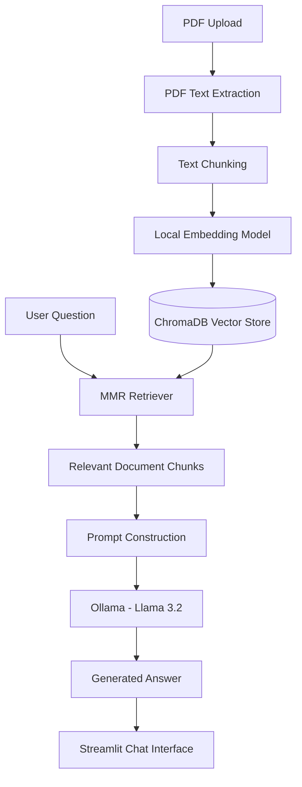

# 📄 Chat with Your PDF — Local RAG Application

A local-first, Retrieval-Augmented Generation (RAG) application that allows users to upload PDF documents and ask questions about their content using natural language.

Built using **Python, LangChain, ChromaDB, Sentence Transformers, Ollama and Streamlit**, this application retrieves relevant document context and generates answers using a locally running Large Language Model (LLM).

The goal is to build a practical document question-answering system while keeping data processing and inference local, without requiring paid API keys.

---

## ✨ Features

- **PDF Upload:** Upload PDF documents through an interactive Streamlit interface.
- **Text Extraction:** Extract text from PDF pages using LangChain document loaders.
- **Intelligent Chunking:** Split extracted text into overlapping chunks using Recursive Character Text Splitter.
- **Local Embeddings:** Generate semantic embeddings using a Sentence Transformers model.
- **Vector Database:** Store document embeddings locally using ChromaDB.
- **Semantic Retrieval:** Retrieve relevant document chunks using Maximum Marginal Relevance (MMR).
- **Local LLM Inference:** Generate answers using Llama 3.2 through Ollama.
- **Source Inspection:** View retrieved document excerpts and their corresponding page numbers.
- **Conversational Interface:** Ask questions through a Streamlit chat interface.

## 🧰 Tech Stack

| Component            | Technology                       |
| -------------------- | -------------------------------- |
| Programming Language | Python                           |
| Frontend             | Streamlit                        |
| RAG Framework        | LangChain                        |
| PDF Processing       | PyPDF                            |
| Text Splitting       | RecursiveCharacterTextSplitter   |
| Embedding Model      | Sentence Transformers            |
| Vector Database      | ChromaDB                         |
| Retrieval Strategy   | Maximum Marginal Relevance (MMR) |
| Large Language Model | Llama 3.2 (3B)                   |
| Local Model Runtime  | Ollama                           |
| Version Control      | Git and GitHub                   |

## 🏗️ System Architecture

The application follows a modular Retrieval-Augmented Generation pipeline.



### How It Works

1. **Document Ingestion:** The user uploads a PDF, and the application extracts its text page by page.
2. **Text Chunking:** The extracted text is divided into smaller chunks of 1,000 characters with an overlap of 200 characters.
3. **Embedding Generation:** A local Sentence Transformers model converts text chunks into numerical vector representations.
4. **Vector Storage:** ChromaDB stores the embeddings and associated document metadata.
5. **Retrieval:** When a user asks a question, the MMR retriever searches for relevant chunks.
6. **Prompt Construction:** Retrieved context is combined with the user's question.
7. **Answer Generation:** Llama 3.2 generates an answer using the retrieved context.
8. **Response Display:** Streamlit displays the generated answer and provides access to the retrieved sources.

## 📁 Project Structure

```text
chat-with-your-pdf/
│
├── app.py
├── requirements.txt
├── README.md
├── .gitignore
├── .env.example
│
├── config/
│   └── settings.py
│
├── src/
│   ├── ingestion/
│   │   ├── pdf_loader.py
│   │   ├── text_splitter.py
│   │   ├── embedding_model.py
│   │   └── vector_store.py
│   │
│   ├── retrieval/
│   │   ├── retriever.py
│   │   ├── prompt_template.py
│   │   └── test_retrieval.py
│   │
│   ├── generation/
│   │   ├── generation.py
│   │   ├── llm.py
│   │   └── rag_chain.py
│   │
│   └── utils/
│
├── tests/
│
├── ui/
│   ├── chat_interface.py
│   └── sidebar.py
│
└── data/
    ├── uploads/
    └── vectorstore/
```

## ⚙️ Installation and Setup

### Prerequisites

Make sure you have installed:

- Python 3.11
- Git
- Ollama

### 1. Clone the repository

```bash
git clone https://github.com/RudraPatil06/chat-with-your-pdf.git
cd chat-with-your-pdf
```

### 2. Create a virtual environment

```bash
python -m venv .venv
```

Activate it on Windows:

```powershell
.venv\Scripts\activate
```

### 3. Install dependencies

```bash
python -m pip install -r requirements.txt
```

### 4. Set up Ollama

Download and install Ollama from:

[https://ollama.com/download](https://ollama.com/download)

Pull the Llama 3.2 model:

```bash
ollama pull llama3.2:3b
```

Make sure the Ollama service is running before starting the application.

### 5. Run the application

```bash
streamlit run app.py
```

Open the application in your browser:

```text
http://localhost:8501
```

## 💬 How to Use

1. Open the application in your browser.
2. Upload a PDF document.
3. Click **Process PDF**.
4. Wait for document extraction, chunking and embedding generation.
5. Enter a question related to the uploaded document.
6. View the generated answer.
7. Expand **View sources** to inspect the retrieved document excerpts and page numbers.

## 🔒 Privacy and Cost

This project is designed around local processing:

- No paid OpenAI or Gemini API is required.
- Embeddings are generated locally.
- LLM inference runs through Ollama.
- ChromaDB stores vectors on the local machine.
- Uploaded documents are not committed to the GitHub repository.

Internet access is required initially to install dependencies and download the required models. Once everything is downloaded, the core application can run locally.

## 🚀 Future Improvements

- [ ] Support multiple PDF documents with isolated vector collections.
- [ ] Improve document source citations and relevance.
- [ ] Add conversation memory for follow-up questions.
- [ ] Improve error handling and document validation.
- [ ] Add automated testing for ingestion, retrieval and generation.
- [ ] Add Docker support for reproducible deployment.
- [ ] Add performance evaluation for retrieval quality and answer accuracy.

## 👨‍💻 Author

**Rudra Rajesh Patil**

B.Tech — Artificial Intelligence and Data Science

Interested in Machine Learning, Generative AI, Retrieval-Augmented Generation and MLOps.

- GitHub: [@RudraPatil06](https://github.com/RudraPatil06)
- Project Repository: [Chat with Your PDF](https://github.com/RudraPatil06/chat-with-your-pdf)

---

⭐ If you find this project interesting, consider giving the repository a star!
